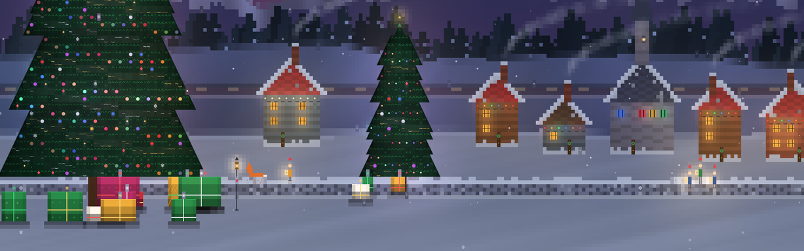
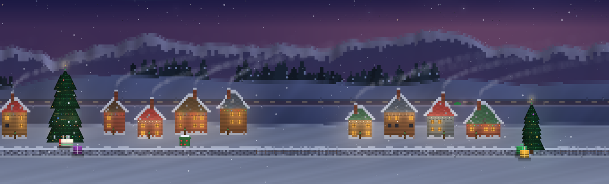

<div align="center">

# 🎄 xmas-tui

**A cozy, glowing Christmas village that lives on the desktop.**

A real terminal UI rendered as an interactive live wallpaper for Linux (KDE Plasma and other Wayland
compositors) and Windows. Snow drifts down, the big tree twinkles, Santa flies past the moon, and a little
villager can wander the streets, chat with the neighbours and feed the deer.

[](https://github.com/dash1101/xmas-tui/releases/latest)
[](https://github.com/dash1101/xmas-tui/actions/workflows/ci.yml)
[](LICENSE)


</div>

## ✨ Highlights

<table>
<tr>
<td width="55%"></td>
<td>

- **A whole village to explore**: about 2½ screens wide, with parallax mountains, a cobbled sidewalk, a
  distant road with traffic and a railway.
- **A villager to walk around**: say hello, pet and feed animals, pick berries, bring friends along.
- **Townsfolk and wildlife**: deer, foxes, rabbits, carollers and kids who chat, play and react.
- **Widgets**: a big clock with a Christmas countdown, system stats, now playing and weather.
- **Synthesized music and sound**: no audio files, all generated live.
- **Snow on open windows**: it piles up on window tops and the taskbar, with string lights.
- **Built-in updates**: it asks first, or installs on its own.

</td>
</tr>
</table>

<p align="center">
  
  
</p>

## 📦 Install

**Linux** (x86_64; needs [kitty](https://sw.kovidgoyal.net/kitty/) ≥ 0.36 and a layer-shell compositor such as
KDE Plasma 6, Sway or Hyprland; GNOME isn't supported):
```bash
curl -fsSL https://raw.githubusercontent.com/dash1101/xmas-tui/main/scripts/get.sh | bash
```
This installs to `~/.local/share/xmas-tui`, keeps settings in `~/.config/xmas-tui/config.toml`, and runs from a
systemd user service that restarts it whenever it exits. Remove it with the same command plus `-s -- --remove`.

**Windows** (10/11, x86_64): download `xmas-tui-windows.zip` from the
[latest release](https://github.com/dash1101/xmas-tui/releases/latest), unzip it anywhere and run `xmas-tui.exe`.
The bundled README covers the rest.

**Updates:** when a new version is out, a small banner asks whether to install it. **Install automatically** under
Settings → Display → Updates skips the question. Downloads are checked against the release's `SHA256SUMS` before
anything is replaced, and `xmas-tui --update` does the same from a terminal.

## 🎮 Controls

Click the bare desktop first so the wallpaper has keyboard focus.

| Input | What it does |
|---|---|
| **WASD** / **arrow keys** | walk the villager; the view follows |
| **E** / **Space** / **Enter** | interact with whatever the `[E]` prompt points at |
| **F** | invite someone along (animals want a berry); with nobody in front, say goodbye to everyone |
| **mouse wheel** | look around the village |
| **drag** a person or animal | carry them about (they'll have opinions), then drop them in the snow |
| **click** things | presents, trees, the snowman, houses, lamps, the moon, the sky… |
| **⚙** or **right-click** | settings |

## 🌟 What's in the scene
- A big tiered tree with light strings that cycle through twinkle, chase, wave, breathe and sparkle patterns,
  plus tinsel, glinting ornaments and a pulsing star.
- Smaller trees with warm, icy and multicolour lights, and presents with ribbons and bows.
- Houses with firelit windows, roofline lights and chimney smoke, plus a church with stained glass.
- Lamp posts, fences, berry bushes and a snowman.
- Three depths of snow in gusty wind, and glinting snowfields.
- A moon with a halo, an aurora, shooting stars, and Santa's sleigh flying past every few minutes.

**Widgets** (each can be dragged anywhere, toggled, and locked in place):
- A big glowing clock with a Christmas countdown.
- A system panel: CPU, GPU, VRAM, RAM, disk and network, with candy-cane bars and sparklines.
- Now playing, from any MPRIS player (Linux) or media session (Windows).
- Weather, from Open-Meteo, which needs no API key.

## 🖱️ Interacting in detail
**Walking around** (click the desktop first so it has keyboard focus)
- **WASD or the arrow keys** walk the little villager (gold coat, green bobble hat) along the snowfield.
  The view follows along; the **mouse wheel** looks around independently.
- **E, Space or Enter** interacts with whatever the `[E]` prompt points at:
  - **people:** say hello and they answer;
  - **animals:** a pat, or (with berries in hand) a snack, after which they tag along for a while;
  - **berry bushes:** pick a few berries (they grow back);
  - **presents, trees, lamps, houses, the church and the snowman:** the same as clicking them.
- **F** invites the person in front to come along (animals need a berry). Companions follow the villager around.
  Stopping near someone else gets the companions talking with them, or with each other. **F** with nobody in
  front says goodbye to everyone.
- The villager can be turned off with **You (WASD)** in the Scene tab.

**Mouse**
- **Drag any widget** to move it. Positions are saved, and can be locked or reset in settings.
- **⚙ (top-right corner) or right-click anywhere** opens settings. Click ◂ ▸ or scroll on a row
  to adjust a value. Click the city field and type a new city. Every change is saved straight to the config.
- **The cursor** leaves a twinkling trail with a soft glow and pushes falling snow aside. Sweep it
  through the snowfield to kick snow up.
- **Clicking things in the scene:**
  - **Presents** wiggle and pop sparkles, and sometimes reveal what's inside.
  - **Trees** blaze. Click a tree's **star** for a starburst.
  - The **snowman** talks back. Try clicking him a few times in a row.
  - **Houses** switch their lights off and on. The **church** rings its bells.
  - **Lamps** sputter.
  - The **moon** summons Santa.
  - **Empty sky** launches a shooting star, and **snow** puffs up.

**Typed easter eggs** (also need keyboard focus)
- Type `hohoho`, `snow`, `joy`, `aurora` or `lights` to trigger an effect.
- There's also one classic cheat code (↑↑↓↓←→←→BA).

**Things that happen on their own**, timed by the "Surprises" setting:
- **Wildlife:** deer, foxes and rabbits wander through and leave footprints.
- **People and travel:** walkers carrying lanterns, often in twos and threes chatting as they go, cars on the
  distant road, and a train with lit carriages.
- **Sky and weather:** wind gusts, short blizzards, meteor showers, aurora flares and a rare comet.
- **Lights:** village-wide rainbow light shows, and houses switching their lights.
- **On a schedule:** church bells on the hour, Santa flying more often on Christmas Eve, and
  fireworks on New Year's Eve.

## 🔔 Tray icon and settings window
While it runs as the wallpaper, a little glowing tree sits in the system tray (KDE Plasma, or any tray that
speaks StatusNotifierItem; the notification area on Windows).
- **Left click** opens a small **settings window**: the same panel, on its own over a snowy backdrop. Typing
  works here, so the weather city can be set without Notepad. The wallpaper picks up every change within
  about a second, through its normal config live-reload. Only one settings window opens at a time.
- **Right click** gives quick toggles:
  - **Linux:** Settings…, Window snow, Sound, Pause effects, Quit wallpaper.
    **Pause effects** freezes the animation and hides window snow and lights until it's unticked. It isn't saved.
  - **Windows:** Settings…, Window snow, Sound, Start with Windows, Quit wallpaper.
- **Quit wallpaper:** under the systemd service, this runs `systemctl --user stop xmas-tui` (a plain exit would
  just be restarted). Otherwise it exits cleanly.
- The settings window also runs on its own: `xmas-tui --settings-window [--config PATH]`.
## 🎶 Sound
Every sound is synthesized live in code. There are no audio files and nothing copyrighted.
- **Ambience:** wind that swells with gusts and blizzards, a soft snowfall hiss, a gently crackling
  fire and very faint distant wind chimes. An aurora flare adds a quiet shimmer.
- **Effects** for what happens in the scene:
  - present shakes and jingles, the snowman's little "hm-hm?" and sleigh bells that pan across with Santa
  - church bells on the hour (and a peal when the church is clicked), fireworks, shooting stars
  - lamp sputters, light-switch clicks, the distant train's chuff and whistle, snow crunching
  - a small fanfare for the typed easter eggs, and an optional airy sparkle when the cursor is flicked
- **Music:** gentle generated pieces in four styles: music box, celesta with a warm pad, soft piano and
  an upbeat sleigh ride. Half are original tunes composed on the spot (different every time); half are
  new arrangements of public-domain carols (Silent Night, Jingle Bells, Deck the Halls, O Christmas Tree,
  We Wish You a Merry Christmas, Good King Wenceslas, Joy to the World).

**Settings → SOUND** has an on/off switch, master, music, effects and ambience volumes, the music style
("shuffle" or one style) and the cursor sparkle. These are also under `[sound]` in the config.

**Output:**
- **Linux:** streams to PipeWire through `pw-cat`, or to PulseAudio through `paplay`. If the player dies,
  it is restarted. No ALSA headers or audio libraries are needed.
- **Windows:** uses `winmm`, which ships with Windows.
- **Latency:** about 50–80 ms.
- **Pausing:** when the wallpaper pauses (for example during a fullscreen game on Windows), the sound
  fades out and the device is released.

**Developer tools:**
```bash
xmas-tui --export-audio DIR && python3 scripts/check-audio.py DIR   # render every sound to WAV, check levels
XMAS_AUDIO_DEV_VOLUME=0 xmas-tui --audio-test 8                      # drive the real output path, silently
```

## ❄️ Snow on open windows
Snow also falls in front of open windows. It settles on the top edge of each window and on the panel, up to
`pile_rows` high (1.5 by default), stacked in eighth-block clumps.
- **Moving a window** carries its pile along with it.
- **Shaking or flinging a window** throws the snow off.
- **Sweeping the cursor** through a pile brushes the snow away.
- **Closing or minimizing a window** drops its pile.
- **Lights:** twinkling bulbs hang on a wire around the six topmost windows, and droop along the top edge.

Both effects can be switched on or off in settings ("Snow on windows" / "Lights around windows") or in `[windows]` in
the config. Everything is hidden while a fullscreen app is in front.

**How it works on KDE:** Wayland doesn't let apps see other windows. So xmas-tui loads a tiny KWin script
(`kwin/xmas-snow.js`) that reports window positions over D-Bus, and it unloads the script again when xmas-tui stops.
The snow and lights are drawn on a transparent, click-through overlay layer, so it never blocks clicks. Damage is
merged into tiles; that keeps KWin's own cost at about 0.4% of a core.

**How it works on Windows:** a click-through, always-on-top layered window covers the wallpaper's monitor. Window
positions come from `EnumWindows` plus DWM's visible frame bounds; the taskbar counts as a panel. It polls about 30
times a second, about 60 while a window is being dragged, and 4 times a second (window hidden) when there's nothing to
draw or a fullscreen app is running. Sizes follow the monitor's DPI scaling.

Debugging: running with `XMAS_SNOW_DEBUG=1` writes `snow-debug.txt` and `snow-canvas.png` to
`$XDG_RUNTIME_DIR/xmas-tui/` (KDE) or `%TEMP%\xmas-tui\` (Windows; a directory path as the value is used instead).
On Windows the status line also has per-phase timings. `XMAS_WINFX=1 xmas-tui --windowed` starts the Windows overlay
next to a normal window, for testing (e.g. under Wine).

## 🪟 Windows
`dist/xmas-tui-windows.zip` holds a standalone `xmas-tui.exe`; its README explains how to use it.
- **How it runs:** it draws the same grid itself, with fonts bundled inside the `.exe`, and attaches behind the
  desktop icons on the main monitor. It pauses during fullscreen games.
- **Controls:** ⚙ (top-right corner) opens settings, which include **Start with Windows** and **Quit**.
  Walking works too: click the bare desktop, then use WASD / the arrows, E and F (the wheel can't scroll the view
  there, because the icon layer sits on top).
- **Weather city:** clicking the city field opens the config in Notepad, because a wallpaper behind the icons
  can't receive typing.
- **Window snow and lights:** see above; they're on by default and run in front of all windows.
- **Fallback:** `--windowed` runs it as a normal window. That's useful with Lively Wallpaper if the
  desktop attach doesn't work on some Windows build.

Releases are built on Windows by CI. To cross-compile from Linux instead, run `./scripts/build-windows.sh`; it
needs the `x86_64-pc-windows-gnullvm` Rust target plus [llvm-mingw](https://github.com/mstorsjo/llvm-mingw) in
`~/.local/llvm-mingw` (or set `LLVM_MINGW`).

**What has been tested:**
- It cross-compiles cleanly, and the `.exe` needs only DLLs that ship with Windows.
- Under Wine 11.22 it renders, and CPU, RAM, disk, network and weather all work.
- Under Wine, the window snow overlay finds the windows and a taskbar, piles snow on them, draws the lights, drops a
  closed window's pile, and shuts down cleanly when the app closes.

**Not yet tested on real Windows:** the desktop attach (classic and 24H2), clicks and keys through the icon layer,
GPU %, now-playing, the fullscreen pause, Start with Windows, self-updating, and the window snow overlay's real
CPU/DWM cost.

**Desktop attach:** on Windows 10 through 11 23H2 the wallpaper becomes a child of the WorkerW that Explorer creates
behind the icons. On Windows 11 24H2's "raised desktop" (Progman has `WS_EX_NOREDIRECTIONBITMAP`, and both the icon
view and the WorkerW are Progman's children), it becomes a layered child of Progman, placed between the icons and
the WorkerW, as Lively Wallpaper does. Layered child windows need the app manifest
(`packaging/windows/xmas-tui.manifest`, embedded by `build.rs`) to declare Windows 8+ support.

The same native window also works on Linux with `--windowed`.

## 🦌 Animals, people and berry bushes
Deer, foxes, rabbits, people carrying lanterns (often in small groups) and pairs of kids wander through. Animals often
stick around for a few minutes. They also interact:
- **Petting and greeting:** passers-by stop to pet animals (hearts float up), greet each other and say hi to the snowman.
- **Conversations:** people walking together stop for a chat now and then, and strangers who meet sometimes do too.
  Each line pops up in turn over whoever's speaking. Drop two people next to each other, or lead companions
  over to someone, to get one going.
- **Play:** a fox plays chase with a rabbit (the fox never catches it), and kids have snowball fights.
- **Snacking:** animals stop at the snow-capped berry bushes. The berries get eaten and regrow a minute or two later.
- **The cursor:** animals startle when it rushes at them, and come over curious when it rests nearby.

**Pick anyone up:** press on them and drag to carry them around. They wiggle and comment while being carried. Let go
to drop them back in the snow; people get a little dizzy. A click without dragging is a pat or a friendly hello. Clicking
a bush rustles it, and sometimes a cardinal flies out or a rabbit pops out.

The Scene tab sets how many visitors come by ("Animals & people") and turns the bushes on or off.

## ⚙️ Settings


The settings panel (⚙ or right-click, or the tray icon's standalone window) has five tabs:
- **Scene:** snow, wind, glow, surprises, visitors, sleigh, frame rate, aurora, bushes, and the villager.
- **Display:** clock, widgets, weather city and units, widget layout, updates.
- **Sound:** master, music, effects and ambience volumes, music style, a per-layer ambience mix, and **Quiet while
  other media plays**. When on, the sound fades out as soon as a browser video or music player starts, and comes
  back a few seconds after it stops.
- **Effects:** a separate volume for each kind of effect, 16 in all.
- **Windows:** the snow on open windows and the lights around them:
  - pile height, density and settling speed
  - **falling snow in front of windows** on/off (piles still grow when it's off)
  - snow on the taskbar
  - light colours (multicolour, warm white, icy blue, candy cane), how many windows get lights, and brightness

## 🔁 Staying on
It runs as a systemd user service (`xmas-tui.service`) that starts with the graphical session.
If it ever exits, the service starts it again within about 3 seconds. That covers the monitor deep-sleeping
and disconnecting (which removes the wallpaper surface), crashes, and so on. Before relaunching, it waits until a
monitor is actually connected again.

## 🔧 How it works
- **Rendering.** Everything is a character grid. The backdrop (sky, moon,
  mountains, houses) uses half-block `▀` pixels. Everything else is real
  glyphs: `^ ◢ ◣ ● ★ ❄ ┼ ━ ▰`.
- **Glow.** Light sources write into a light buffer. It is blurred at two
  radii and added to the colors of nearby cells, which gives halos around
  bulbs and warm pools of light on the snow.
- **Efficient output.** Only changed cells are sent, inside synchronized-output
  blocks so a half-drawn frame never shows.
- **Wallpaper.** `kitten panel --edge=background` puts a kitty terminal on
  the Wayland background layer, so it sits behind every window.

## 🛠️ Building from source
```bash
cargo build --release
./scripts/install.sh            # default config + systemd user service, start now
./scripts/install.sh --remove   # stop it and remove the service
systemctl --user restart xmas-tui   # restart it by hand (status/stop work too)
./scripts/xmas-wallpaper.sh     # start the wallpaper manually
./target/release/xmas-tui       # run inside any truecolor terminal (q or Esc quits)
```
A build from source never updates itself; pull and rebuild instead. Releases are cut by pushing a `vX.Y.Z` tag
(matching `Cargo.toml`): CI builds both platforms and publishes them with `SHA256SUMS`.
Config lives at `~/.config/xmas-tui/config.toml`. See `config.example.toml`
for every option, including the weather city.

Developer tools:
```bash
xmas-tui --export DIR --size 568x75 --frames 1 --at 20 --sleigh   # render frames to PNG (--pan CELLS to look around)
xmas-tui --export X --frames 720 --fps 24 --clean --raw | ffmpeg -f rawvideo -pix_fmt rgb24 -s 5112x1425 -r 24 -i - out.mp4  # a video
xmas-tui --bench 300 --size 568x75                                 # timing + bytes per frame
xmas-tui --settings-window --export DIR                            # settings window + tray icons to PNG
xmas-tui --bench 300 --size 568x75                                 # timing + bytes per frame (+ window fx on Linux)
```

## 📋 Requirements
- kitty ≥ 0.36, for background panels.
- Rust toolchain (only to build from source).
- `busctl`, for the music widget (part of systemd).

## 📊 Performance
Measured on a 5120×1440 screen (the size it was designed for; it adapts to any other).

| | |
|---|---|
| Grid at `font_size=10` | 568×75 cells, about 9×19 px per cell |
| Frame cost | ~2.6 ms of CPU (scene 0.4, compose 1.7, encode 0.5) |
| Terminal output | ~70 KB per frame, ~16% of cells change |
| Live at 30 fps | xmas-tui ~10% of one core, kitty ~10% of one core |
| Memory | xmas-tui 17 MB, kitty 174 MB |

## 📜 License
MIT, see [LICENSE](LICENSE). Bundled fonts: DejaVu (Bitstream Vera license) and Noto Sans Symbols 2 (SIL OFL);
their licenses are in `assets/fonts/`. The carol arrangements are of public-domain tunes.
