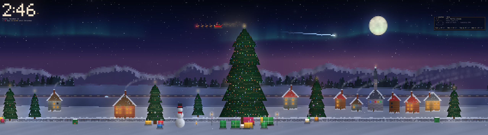
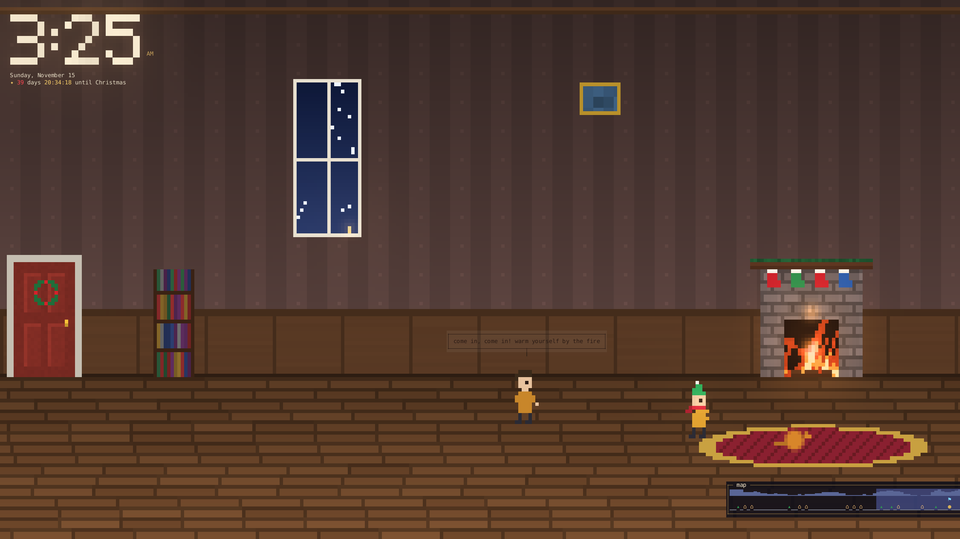
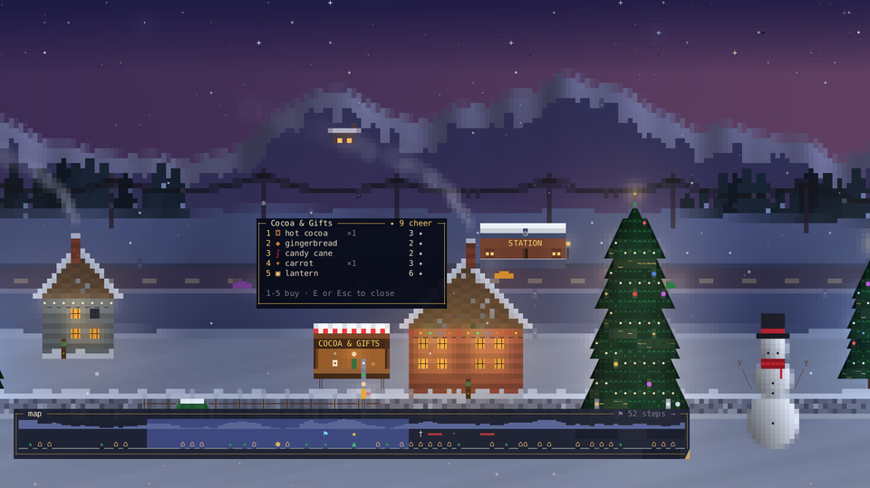
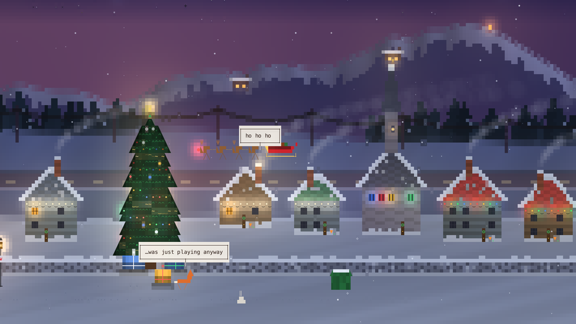
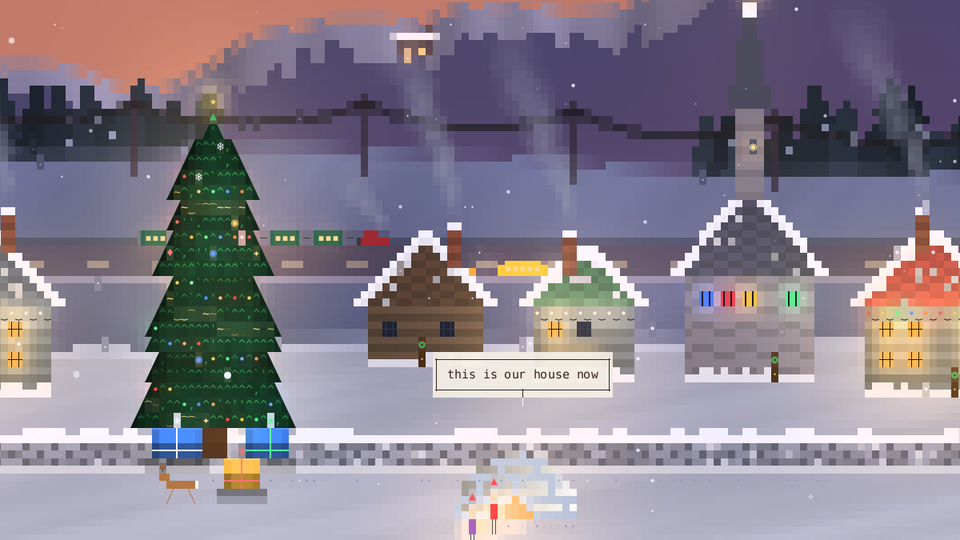
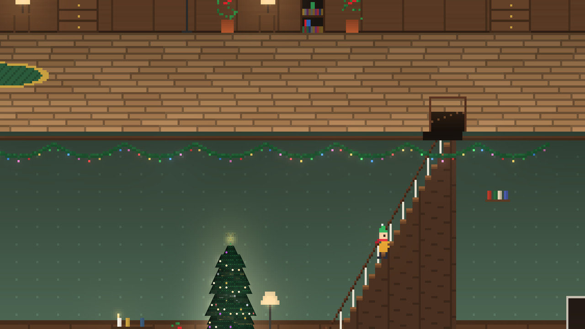
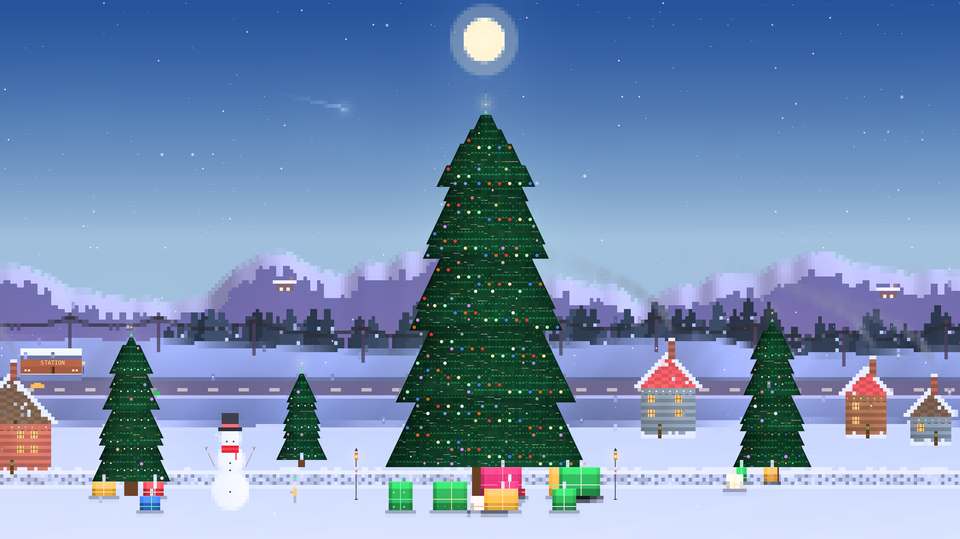
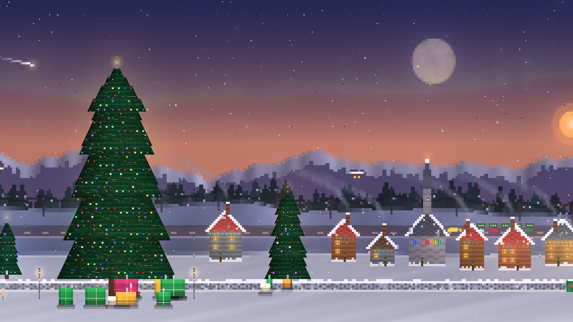
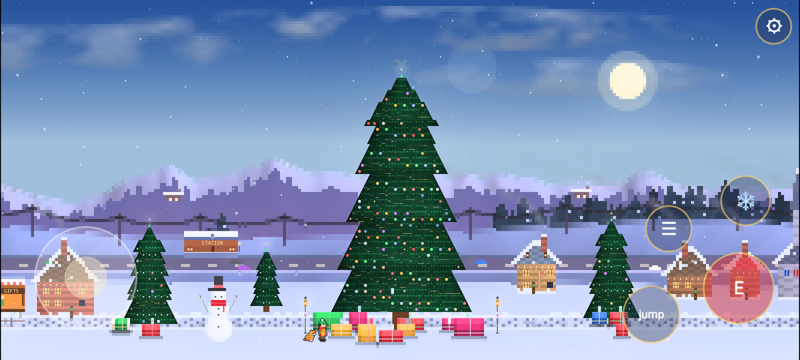
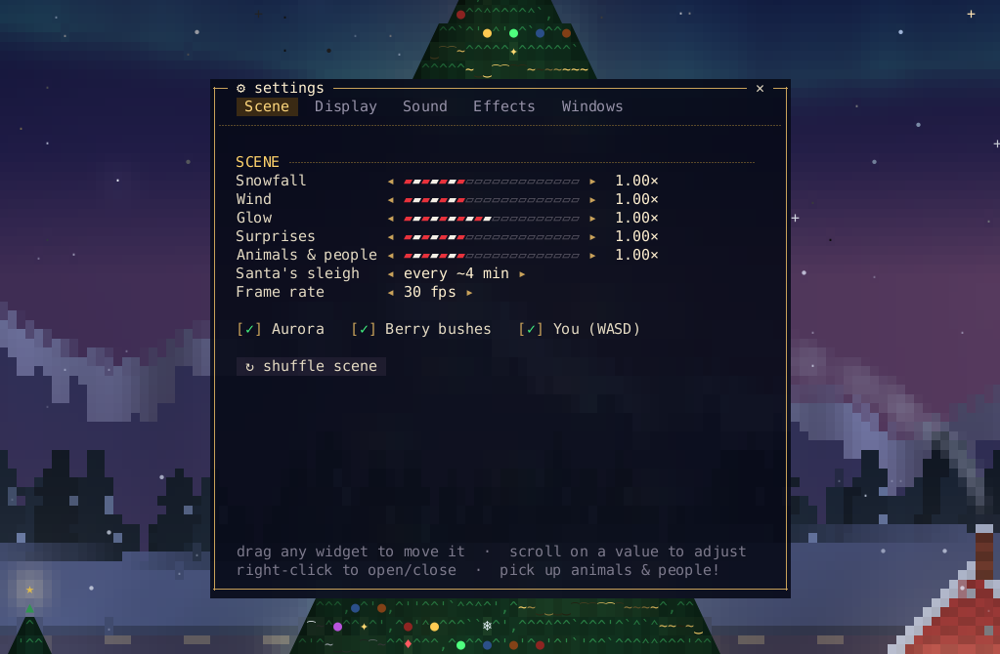

<div align="center">

#  xmas-tui

**A cozy, glowing Christmas village that lives on the desktop.**

A real terminal UI rendered as an interactive live wallpaper for Linux (KDE Plasma and other Wayland
compositors) and Windows. Snow drifts down, the big tree twinkles, Santa flies past the moon, and a little
villager can wander the streets, chat with the neighbours and feed the deer.

[](https://github.com/dash1101/xmas-tui/releases/latest)
[](https://github.com/dash1101/xmas-tui/actions/workflows/ci.yml)
[](LICENSE)




</div>

## ✨ Highlights

- **A whole village to explore**: about five screens wide, with open stretches of snow between the houses, parallax
  mountains, lit cabins on the slopes, a cobbled sidewalk, two-lane traffic, a railway with a station, and a sky
  above the sky.
- **Things to do** (**T**): snowmen and igloos (and inside the igloos, a room of their own), snow angels, a rest in the
  snow under the stars, carols the neighbours join in with, tag, team snowball fights with whoever's tagging along,
  a light show of any length, fireworks, and a game of chess, checkers, Snowflakes or Twenty-One round the table in
  someone's home (up to four at the cards, dealt off a real deck that slides across the table). A scorecard keeps
  count.
- **Trips out**: the train from the station up to a ski lodge (skis from the shop, the chairlift, then a run down
  the mountain through the flags), and a night drive in the car parked by home.
- **Friends and shared villages, online** (the **✉ friends** button): add friends by friend code, write to them,
  open a village to them or walk into theirs, and play together in real time: chess, checkers and cards round the
  table in the games room, tag, snowball fights, races down the mountain, the train up to the slopes, light shows
  and fireworks everyone sees. A profile card with the villager's own look, one villager across a phone, a laptop
  and a desktop (linked devices), and more than one villager on a device. On the desktop, the web and a phone alike;
  opt-in, through a free public relay, sealed end to end.
- **Play in a browser**: the same village on the web at **[dash1101.github.io/xmas-tui](https://dash1101.github.io/xmas-tui/)**,
  with sound, the same menus and settings, and touch controls on a phone.
- **A villager to walk around**: say hello, pet and feed animals, pick berries, throw snowballs, bring friends
  along, step inside houses, and spend "cheer" at the cocoa cabin (a log cabin with a fire, tables, shelves of gifts
  and the shopkeeper behind the counter).
- **Townsfolk and wildlife**: named neighbours who hold real back-and-forth conversations about what's going
  on, react to shooting stars, Santa, fireworks and power cuts, gather for the light shows and step around
  each other; kids who build snowmen and igloos (and pile inside) and start snowball fights; deer, foxes and
  rabbits too.
- **Talk like a story game**: a dialogue box with choices. Everyone has their own way of talking (warm, chatty,
  shy, cheeky, dreamy or gruff-but-kind) and remembers the villager; every grown-up has a job and a mood, every kid
  a wish, and the talk follows whatever's going on, including what they just saw the villager do.
- **Homes worth visiting**: every house is its own household (the baker's, the toymaker's, the bookworm's…) with a
  family that potters about, a cat or dog, chairs to sit in, an oven, books, music, little jobs to help with, and
  windows that look out on the real village.
- **A home and a pet of the villager's own**: a house with a parlour, a kitchen, a bedroom upstairs and an attic with
  a telescope (walk up the stairs and the view follows), a sofa to sit on, a bed to sleep in and an oven that bakes
  gingerbread for the pockets; and a dog, cat or bunny (named, coloured, and remembered) that follows everywhere,
  fetches, does tricks, eats from its bowl, gets cuddled and brushed, naps, and plays with other animals.
- **Play it like a game**: pop the village out into its own window, or take the wallpaper itself full screen and
  back (nothing restarts); zoom in on the villager with Ctrl +/-.
- **Sharp at any size**: Resolution (Ctrl Shift +/-) adds detail without shrinking anyone. Rooms, people and
  animals keep their size on a finer grid.
- **Christmas Eve and New Year's Eve**: the village goes to bed while Santa does his rounds roof by roof, leaving
  presents under the tree; on New Year's Eve there's a ball drop, a big countdown and a midnight party.
- **Day and night**: follows the real sunrise and sunset at the weather city, or stays at a chosen time.
- **Widgets**: a big clock with a Christmas countdown, system stats, now playing, weather, a village map and an
  audio visualizer.
- **Shelves**: tidy desktop shortcuts and files onto frosted panels, wooden shelves or gift boxes, with their real
  icons or as pixel art.
- **Synthesized music and sound**: no audio files, all generated live, with live level meters.
- **Snow on open windows**: it piles up on window tops and the taskbar, with string lights.
- **Installers and updates**: a per-user Windows setup, a `.deb`, a no-sudo Linux installer, and built-in updates.

<p align="center"></p>

## 📸 A look around

<table>
<tr>
<td width="50%"><br><sub><b>Inside a house</b>: walk up to a front door and press E.</sub></td>
<td width="50%"><br><sub><b>The church</b>: stained glass, candles and an organ to play.</sub></td>
</tr>
<tr>
<td><br><sub><b>Cocoa & Gifts</b>: spend cheer on cocoa, gingerbread, carrots and a lantern.</sub></td>
<td><br><sub><b>Above the clouds</b>: Ctrl+wheel looks up to constellations and a balloon.</sub></td>
</tr>
<tr>
<td><br><sub><b>Christmas Eve</b>: everyone's in bed, carrots are out, and Santa goes roof to roof.</sub></td>
<td><br><sub><b>New Year's Eve</b>: the ball drops, the sky counts down, and midnight is a party.</sub></td>
</tr>
<tr>
<td><br><sub><b>Conversations</b>: pick what to say with 1-5 or a click.</sub></td>
<td><br><sub><b>Kids at play</b>: snowmen, igloos (with them inside) and snowball fights.</sub></td>
</tr>
<tr>
<td><br><sub><b>Upstairs</b>: the view follows the villager up into the bedroom.</sub></td>
<td><br><sub><b>More resolution, same size</b>: everyone drawn to scale on a finer grid.</sub></td>
</tr>
<tr>
<td><br><sub><b>Noon</b>, with the time of day set to follow the real sun…</sub></td>
<td><br><sub>…and <b>dusk</b>, as the lights come on.</sub></td>
</tr>
</table>

## 📦 Install

| Platform | Download | Notes |
|---|---|---|
| **Windows** 10/11 | `xmas-tui-setup-x86_64.exe` | Per-user install (no admin needed), Start menu entries, optional run at startup, uninstaller. |
| | `xmas-tui-windows.zip` | Portable: unzip anywhere and run `xmas-tui.exe`. |
| **Linux** (no sudo) | `xmas-tui-linux-installer.sh` | Installs to `~/.local/share/xmas-tui` with a systemd user service; updates itself. |
| **Debian / Ubuntu** | `xmas-tui_*_amd64.deb` | System-wide (dpkg always needs sudo). Then open **xmas-tui** from the app menu and click *set it up* on its banner (or Settings → Desktop → *set as the desktop wallpaper*). Updated through the package manager. |
| **Android** 7+ | `xmas-tui-android.apk` | The whole village to play in (joystick and buttons, or a game controller); the live wallpaper is the same village on autopilot. See [Android](#-android-the-live-wallpaper-and-the-village-to-play-in). |
| **Web** | [dash1101.github.io/xmas-tui](https://dash1101.github.io/xmas-tui/) | Nothing to install: the village in the browser (keyboard and mouse, or touch controls on a phone), with sound. Saves in the browser, and imports a desktop or phone save (the villager's name, pet and friends too). |

All of these are on the [latest release](https://github.com/dash1101/xmas-tui/releases/latest). Both platforms also
have a one-line installer straight from the repo. On **Linux** (no sudo):
```bash
curl -fsSL https://raw.githubusercontent.com/dash1101/xmas-tui/main/scripts/get.sh | bash
```
On **Windows**, in PowerShell (per-user, no admin; installs the latest release with run at startup, then starts it):
```powershell
irm https://raw.githubusercontent.com/dash1101/xmas-tui/main/scripts/get.ps1 | iex
```
The Linux one-liner also puts the `xmas-tui` command in `~/.local/bin`, and offers (asking first) to install kitty
when it's missing and ffmpeg for the moving lock screen (that one through the system's package manager, with sudo).
Linux needs [kitty](https://sw.kovidgoyal.net/kitty/) (0.34 or newer on Wayland, 0.42 or newer on X11; Debian 13's
0.41 works) and a layer-shell compositor such as KDE Plasma 6, Sway or Hyprland (GNOME isn't supported). Without a
suitable kitty, *set as the desktop wallpaper* (Settings → Desktop, or `xmas-tui --set-wallpaper` in a terminal)
fetches the official build into `~/.local/kitty.app` (checked against the checksum GitHub lists for it), no sudo
needed. Settings live in `~/.config/xmas-tui/config.toml` (Linux) or `%APPDATA%\xmas-tui\config.toml` (Windows).
Remove the Linux install with the same command plus `-s -- --remove`.

**Lock screen (KDE Plasma 6):** Settings → Desktop → *The village on the lock screen* renders a seamless looping
video of the village (a still image when ffmpeg isn't installed: *install ffmpeg* there fetches it through the
system's password prompt) and makes it the lock screen's wallpaper through a
small Plasma wallpaper plugin. Unticking it puts the previous lock screen wallpaper back; `xmas-tui --lock-screen
on|off` does the same from a terminal.

**The save file:** the village (the seed it's laid out from, so the houses, and home, stay put from one start to the
next) and the villager's pockets, stats and scorecard, kept in `~/.local/share/xmas-tui/save.toml`
(`%APPDATA%\xmas-tui\save.toml` on Windows), written every minute and on the way out. Settings → Village → *export
save* puts a copy in Documents; *import save* loads one (from another computer, say). A `seed` set in the config
still wins.

**Updates:** when a new version is out, a small banner asks whether to install it. **Install automatically** under
Settings → Desktop → Updates skips the question. Downloads are checked against the release's `SHA256SUMS` before
anything is replaced, and `xmas-tui --update` does the same from a terminal. **Run at startup** sits in the same tab.

## 🎮 Controls

Click the bare desktop first so the wallpaper has keyboard focus.

| Input | What it does |
|---|---|
| **WASD** / **arrow keys** | walk the villager; the view follows (hold **Shift** to run) |
| **E** / **Enter** | interact with whatever the `[E]` prompt points at (people, animals, bushes, doors, the cabin…); with nothing else around, the villager's pet |
| **Space** | jump; held, higher (up to twice as high); in the air, again: the Christmas spirit lifts the villager once more; steer in the air with **A** / **D**. Up against a house, a tree, a lamp post, the cabin, a present, a widget or a window, a leap right up onto it (a tall tree: its lowest branch in reach) |
| **W** up on something | on up it: a roof to its ridge, a tree branch by branch to the star; **S** hops down |
| **T** | things to do right here: build, a snow angel, a rest, a carol, tag, a team snowball fight, a light show, fireworks, the ski trip, a drive, a game at the table indoors… (**1**–**9** or the arrows and **Enter** to pick) |
| **O** | friends & online (also the **✉ friends** button, top right): go online, the friend code, add a friend, write, open this village or go into a friend's, play with friends there, the profile card, linked devices |
| **Y** / **N** | yes (or no thanks) to what a friend online asks (a game, tag, a race, the train); clicking the question works too |
| **Z** | lie down in the snow for a rest (stars at night, a doze); **Space** then makes a snow angel; any direction key gets up |
| **F** | invite someone along (animals want a berry); with nobody in front, say goodbye to everyone |
| **R** | scoop a snowball, press again to throw it |
| **Q** | what's in hand: berries or something from the pockets (E then gives it, or uses it) |
| **I** | show or hide the pockets |
| **1**–**5**, or **↑ ↓** and **Enter** | answer in a conversation (or choose in any menu), use an item, or buy one while the cabin's menu is open |
| **Esc** | close a menu, conversation or window view; with nothing open, the settings |
| **C** | the view back on the villager (also the **⌖ centre** button, top right) |
| **?** / **F1** | the controls card (also the **? controls** button, top right); click a **[key]** on it to change that key |
| **A** / **D** at a window | lean to look further along the street |
| **mouse wheel** / **Shift+wheel** | look along the village / up into the sky |
| **trackpad** | two fingers up and down: up into the sky and back; sideways: along the village; a pinch (or Ctrl + two fingers): zoom |
| **right-click**, or **press and hold** | options for whatever's under the pointer: drop in from the sky, walk over, say hello, give a gift, visit a house, the villager's stats… (settings at the bottom) |
| **drag** anyone (the villager and the pet too) | carry them about, then drop them in the snow |
| **click** things | presents, trees, the snowman, houses, lamps, the station, the moon, the sky… |
| **⚙ settings** (top right) | the settings panel; drag its title bar to move it |
| **F11** | full screen and back: the wallpaper itself, or a popped-out window |
| **Ctrl +** / **Ctrl -** / **Ctrl 0**, **Ctrl+wheel**, the **− +** buttons | zoom in (up to 4×), out, back to 1× (it eases in) |
| **Ctrl Shift +** / **Ctrl Shift -** | resolution: finer or coarser detail, everything the same size |

## 🌟 What's in the scene
- A big tiered tree with light strings that cycle through twinkle, chase, wave, breathe and sparkle patterns,
  plus tinsel, glinting ornaments and a pulsing star.
- Smaller trees with warm, icy and multicolour lights, and presents with ribbons and bows.
- Houses with firelit windows, roofline lights and chimney smoke, plus a church with stained glass. Every one
  can be visited.
- Lamp posts, fences, berry bushes, a snowman, the Cocoa & Gifts cabin and the railway station.
- Villagers and pets drawn as detailed pixel-art sprites (in the window, and in kitty through its graphics
  protocol): faces, mittened hands that swing, wave and pet, scarves and lanterns; dogs, cats and bunnies with
  their own walk, sit, beg, eat and curled-up sleeping poses. Other terminals show simpler text-character folk.
- Pets speak in little bubbles: a cat meows, purrs and hisses, a dog woofs, pants and growls, a bunny thumps and
  sniffs.
- Every few minutes the church bell rings and a few folk go in for the service, to come out a while later; now
  and then someone pops in on their own.
- Three depths of snow in gusty wind, and glinting snowfields.
- A moon with a halo, an aurora, shooting stars, and Santa's sleigh flying past every few minutes. Higher up:
  the Milky Way, constellations, the North Star, a hot-air balloon and the odd satellite.
- A subtle powerline along the hills. (Click it enough times and see what happens.)

**Widgets** (each can be dragged anywhere, toggled, and locked in place; all but the clock can be resized by
dragging the ◢ in their bottom-right corner):
- A big glowing clock with a Christmas countdown (and the seconds, in smaller digits beside it, if wanted).
- A system panel: CPU, GPU, VRAM, RAM, disk and network, with candy-cane bars and sparklines.
- Now playing, from any MPRIS player (Linux) or media session (Windows).
- Weather, from Open-Meteo, which needs no API key.
- A map of the whole village: where the villager is, where they started (⚑), what's on screen, trains and
  townsfolk. Click it to look somewhere; drag its ◢ corner to resize it.
- A visualizer (off until switched on): bars in Christmas colours dancing to whatever's playing, each with a cap
  of snow that settles back down, standing on a strip of ice that reflects them. **kHz labels** write each bar's
  frequency on the ice. It listens to the default audio output (the sink's monitor through `pw-record` or `parec`
  on Linux, WASAPI loopback on Windows), only while it's on; nothing is recorded or sent anywhere.
- Shelves: see below.

### Shelves
A shelf shows a folder's files and shortcuts, so the desktop can stay tidy and everything still has a place. What's
on a shelf is an ordinary file in its folder (`Documents/Desktop Shelves/<name>`, or any folder picked), so it can
always be found in Explorer or Dolphin.
- **Making one:** right-click (or press and hold) on the bare scene → *new shelf here* (a folder of its own) or
  *new shelf from a folder…* (any folder, picked with the system's folder picker: a Music shelf, say), or Settings →
  **Shelves**. That tab also renames shelves (the folder is renamed with them), picks a shelf's folder, and changes
  their look and icons; a shelf's own menu has *choose its folder…* too.
- **Using it:** double-click an item to open it; long-press or right-click it for *open*, *show in its folder* and
  *take off the shelf*. Drag an item to another spot on the same shelf to rearrange it (the order is kept), onto
  another shelf to move it there, or off the shelves to put it back on the desktop (on Windows, where it's let go).
  A shelf with more than fits has a scrollbar inside its right edge (drag it, or click along it; the wheel works
  too) and says which items are showing (*1–8 of 26*). Click the title to roll the shelf up to one line; drag any
  edge or corner to resize it.
- **On Windows:** drag desktop icons straight onto a shelf to put them away (the shortcuts on the shared "all
  users" desktop need admin rights to move, so they stay). Moves go through Explorer, so Ctrl+Z on the desktop
  undoes them.
- **Looks:** a frosted panel with snow piled on top (the default), a wooden shelf with snow on its planks, or a
  gift box with a gold ribbon and a bow.
- **Icons:** each item's real icon, or the same icon redrawn as chunky pixel art. On Windows they're the shell's
  icons and thumbnails. On Linux: an app's PNG icon, a picture's own image, the cover art inside music files (MP3,
  FLAC, M4A, Ogg/Opus; wide video thumbnails are cropped to the square cover in the middle), or an album folder's
  `cover.jpg`; otherwise a little drawing of the file type. Real icons need kitty (or the window).

## 🖱️ Interacting in detail
**Walking around** (click the desktop first so it has keyboard focus)
- **WASD or the arrow keys** walk the little villager (gold coat, green bobble hat) along the snowfield.
  The view follows along; the **mouse wheel** looks around independently. **Walk speed** is in the You tab.
- **Parkour.** **Space** jumps, with **A** / **D** to steer in the air. At the back of the snowfield, up against a
  house, a tree, a lamp post, the station, the cocoa cabin, a present or the snowman, it's a leap right up onto it.
  On top, **A** / **D** walk along it, up and down the slopes of a roof (a chimney or the steeple is a wall), and off
  the end drops back down into the snow; another **Space** jumps from up there, so it's possible to leap from roof to
  roof; **S** hops down. The tops of the widgets are ledges too: **Space** under a widget leaps up onto it, and it
  stays put while the village scrolls past below. So are the **open windows** (on Windows, and on KDE Plasma): the
  villager can leap up onto a window's title bar, or drop in on it from the right-click menu, and rides along when
  the window's dragged about; closing it drops them back down. The pet waits underneath. A fall from high up ends
  in a dizzy tumble; a jump or hop down lands on its feet.
- **Back to the villager.** After looking along the village with the wheel (or the map), **C** or the **⌖ centre**
  button (top right) brings the view back to the villager.
- **Autopilot** (You tab, off by default). Left alone for about 20 seconds, the villager goes about a day of their
  own: lending the kids a hand with a snowman or igloo (or starting one, and sometimes crawling into the finished
  igloo for a rest), snowballs at the neighbours, berries off a bush for the animals, a chat (answering for
  themselves), a game with the pet, a game of tag with one of the kids (tag, run off, get tagged back), a look round
  from a rooftop, a knock at a neighbour's door for a game of chess, checkers or cards (sat down at their table,
  played out to the end on the panel, then a handshake and out again), or just a wander. A direction key, any of the villager's keys, picking someone up or choosing
  something from the right-click menu takes over again at once; it waits another 20 seconds before carrying on.
- **Games at the table.** Indoors, **T** (or a right-click) → a game with whoever's at home: chess, checkers,
  Snowflakes or Twenty-One (at the cards, up to three of the household round the table). The villager sits down, and
  so do they. The arrow keys (or a click on the board, a card or the deck) choose, **Enter** plays, **Esc** gets up.
  The cards come off a real deck, sliding across the table to each hand, and at Twenty-One the dealer's hidden card
  turns over at the end. Only the buttons under the game (*hit*, *stand*, *draw a card*, *again*, *pass the deal*),
  the board, the cards and the deck play anything when clicked, so a click to bring the window forward never plays
  a card. At Twenty-One **P** (or *pass the deal*) passes the deal round the table: a neighbour dealing keeps to the
  house rule (another card under 17); dealing yourself, you play last, and choose.
- **Building with the kids.** Right by a snowman or igloo going up, **E** lends a hand: each press pushes the
  snowball bigger or sets another block, the kids cheer the villager on, and it goes up far faster. Right-click open
  snow for **build a snowman here** or **build an igloo here** to start one; kids nearby come over to help. What the
  villager helped build gets a touch of theirs (their red scarf on the snowman, a flag on top of the igloo) and
  earns cheer. **E** at a finished igloo's doorway crawls inside, out of the cold, until a direction key (or E)
  crawls back out.
- **E or Enter** interacts with whatever the `[E]` prompt points at:
  - **people:** a conversation opens in a dialogue box: they say something, and **1**–**5** (or a click, or E for
    the first answer) picks what to say back. Grown-ups talk about how they are, their job, tips for a newcomer
    and what's going on (the snow, the train, the light show…), and can be asked to walk along; kids talk about
    what they're up to, what they want for Christmas and Santa, and are always up for a snowball fight. A cocoa
    in the pockets can be handed over to someone who'd like one. People notice what's around them, too: kids
    building a snowman ask for a hand (and get one), kids mid-snowball-fight can be joined, and anyone nearby
    mentions what they just saw the villager do: feeding or petting an animal, throwing snowballs, handing out
    presents, carrying someone about, dropping in from the sky, coming out of a house. The box can be dragged
    anywhere and stays there. Walking away or Esc ends it;
  - **animals:** a pat, or (with berries in hand) a snack, after which they tag along for a while;
  - **berry bushes:** pick a few berries (they grow back);
  - **front doors:** step inside. Every house is its own: a household with a theme (the baker's oven and cookie
    jar, the toymaker's workbench and a toy train round the tree, the bookworm's shelves, the musician's piano and
    gramophone, the sailor's telescope, the candle-maker's glow, the farmer's rocking chair and radio), its own
    wallpaper, floor and furniture, one to three people who move about (warming their hands, sitting down, looking
    out of the window), and often a cat or dog. In there:
    - **talk** to anyone at home in the dialogue box: about their home, their family, how long they've lived there;
      they'll offer a seat or a fresh cookie, play the piano, or ask for a hand (put the star back on the tree, a log
      on the fire, find the cat, play a tune, hang the last stocking) — and are grateful when it's done;
    - **sit** in the armchairs and on the sofas, **bake** (the oven dings when the cookies are done; E again takes
      the tray of gingerbread for the pockets), **read** a book, **play** the piano, gramophone or radio,
      **decorate** the tree, peek in a **stocking**, play with the **pet** (the dog fetches, the cat chases string);
    - **look out of a window**: the real, live village outside, from where that window is (A/D to lean, E or Esc to
      step back). Walk out the door or press Esc to leave;
  - **the villager's own house** (the one with the flag by the door and lights up under the roof): a parlour with
    a sofa, a kitchen next door with an oven and a table, stairs up to a bedroom with a quilted bed, and a ladder up
    to the attic with a round window and a telescope. E at the stairs walks the villager up them while the view
    pans up into the room above (and back down the same way). E on the sofa sits down on it; E on the bed tucks the
    villager in (the room dims, the pet curls up at the foot of the bed) until a direction key gets them up. Each
    window looks out from its own height — the attic's up into the stars;
  - **the pet:** the villager has a dog, cat or bunny that follows them everywhere, indoors too. Turn to face it
    and press E (it comes before anything else in reach), or click it, for its box. The first time it asks for a
    name. After that it can be fussed over; cuddled (scooped up into the villager's arms, hearts and all, until they
    walk off); fed (a bowl goes down, it trots over and eats, and it's full for a while after); sent for a nap (it
    curls up right there, and wakes when the villager moves or is woken from the box); brushed (its coat shines for
    a while); played with (a ball or a stick for a dog, a ball of yarn or the scarf for a cat, a carrot for a bunny,
    tricks, "chase me!"); renamed, given a new look, or asked to stay home. How a game goes varies: a dog might bring the ball straight back, take a victory lap first, or come back
    with a stick; a cat bats the yarn about, unravels it, or curls up round it. Left standing about a while, the pet
    naps. Out in the village a dog chases rabbits and foxes, a cat stalks them, a bunny hops along with rabbits, and
    pets meeting other people's pets have a happy bounce together. With a carrot or gingerbread in hand (**Q**), E
    gives it a treat. Its kind, colour and name live in the You tab (and are remembered);
  - **the cocoa cabin:** opens its menu;
  - **presents, trees, lamps, houses, the station and the snowman:** the same as clicking them.
- **F** invites the person in front to come along (animals need a berry). Companions follow the villager around.
  Stopping near someone else gets the companions talking with them, or with each other. **F** with nobody in
  front says goodbye to everyone.
- **R** packs a snowball, and **R** again throws it at whoever's ahead. People react, and kids often throw one back.
- **Cheer (✦)** is earned by being neighbourly: first hellos, feeding animals, snowball fights, watching a light
  show by the big tree, finding constellations. It buys things at the **Cocoa & Gifts** cabin: hot cocoa (cozy
  glow), gingerbread and candy canes (to give away), carrots (a deer or rabbit becomes a friend) and a lantern.
  **I** shows the pockets; **1**–**5** use what's in them. **Q** picks what's in hand (berries, or anything in the
  pockets; it shows at the bottom left): E then gives it to whoever's in front, or uses it with nobody there.
- **People know the villager's name** once one is set (You tab → Your name): they say it when they see the
  villager again, and word gets round.
- **Right-click** (or **press and hold** the left button for a moment, which works everywhere) shows what can be
  done with whatever's under the pointer, and the villager walks over to do it. On the Windows desktop, right-click
  works on people, animals, houses, the station, the cabin, widget panels and shelves; on open ground, in the sky and on
  desktop icons it's still Windows' own desktop menu (xmas-tui's menus have a *Windows desktop menu…* item too):
  - **open ground:** *drop in here* (the villager shimmers down from the sky and lands with a puff) or *walk over*;
  - **on or just above a roof, a tree, a lamp post, the station, a present or a widget:** *drop in up here*, to
    land right on top of it;
  - **the villager:** the stats card and Christmas list, or the pockets;
  - **people:** say hello, invite along or say goodbye, give a gingerbread or candy cane, throw a snowball;
  - **animals:** pet, feed a berry, give a carrot;
  - **houses and the church:** visit, or switch the lights / ring the bells;
  - **the cocoa cabin, the station, the sky:** shop, ask about the next train, wish on a star.
  The settings are always at the bottom of the menu (and on the **⚙ settings** button).
- **The Christmas list** (on the stats card) has ten little goals: hellos, chats, feeding animals, visiting homes,
  giving a gift, landing snowballs, watching a light show, finding constellations, walking the village end to end,
  and waving down Santa's sleigh.
  Each pays cheer when it's done.
- The villager can be turned off with **Walk about (WASD)** in the You tab; **Walk speed** goes up to 6×.

**Mouse**
- **Drag any widget** to move it. Positions are saved, and can be locked or reset in settings.
- **The ⚙ settings button (top right)** opens settings; drag the panel's title bar to put it anywhere. Click ◂ ▸ or scroll on a row
  to adjust a value. Click the city field and type a new city. Every change is saved straight to the config.
- **The cursor** leaves a twinkling trail with a soft glow and pushes falling snow aside. Sweep it
  through the snowfield to kick snow up.
- **Clicking things in the scene:**
  - **Presents** wiggle and pop sparkles, and sometimes reveal what's inside.
  - **Trees** blaze. Click a tree's **star** for a starburst.
  - The **snowman** talks back. Try clicking him a few times in a row.
  - **Houses** switch their lights off and on. The **church** rings its bells.
  - **Lamps** sputter. The **station** says when the next train is due.
  - The **moon** summons Santa. **Click the sleigh** as it flies past: Santa pulls up for a word with whoever's
    below, or just gives a hearty "ho ho ho".
  - **Empty sky** launches a shooting star, and **snow** puffs up. **Click a shooting star** to catch it (and make a
    wish).
  - **Cars** honk and flash their high beams; **trains** whistle and blaze with light; the **airplane** blinks its
    landing lights; the **owl** hoots; a **flock** of birds scatters; the little **cabins up on the mountains** turn
    their lamps up.
  - Up in the high sky: **constellations** light up and name themselves, the **balloon** fires its burner, and
    the **North Star** grants a wish.

**Typed easter eggs** (also need keyboard focus)
- Type `hohoho`, `snow`, `joy`, `aurora` or `lights` to trigger an effect.
- There's also one classic cheat code (↑↑↓↓←→←→BA).

**Things that happen on their own**, timed by the "Surprises" setting:
- **Wildlife:** deer, foxes and rabbits wander through and leave footprints.
- **People and travel:** walkers carrying lanterns, often in twos and threes chatting as they go; cars in both
  lanes of the distant road (keeping right, or left where the weather city drives on the left); trains that stop
  at the station and let passengers off.
- **Sky and weather:** wind gusts, short blizzards, meteor showers, aurora flares and a rare comet.
- **Lights:** village-wide rainbow light shows (announced first, so everyone gathers round the big tree), and
  houses switching their lights.
- **Sky life:** clouds drifting past (moonlit at night), a blinking airplane, flocks of birds by day, an owl
  across the moon, and paper lanterns floating up from the village. The sky drifts a little as the view scrolls.
- **On a schedule:** church bells on the hour, and on December nights Santa sometimes drops in on a house or two:
  the sleigh hovers by the roof, he climbs over to the chimney and goes down, and another present appears under
  the big tree.

**Special nights** (going by the clock):
- **Christmas Eve** (from 6 pm): the kids put carrots out on the doorsteps in the afternoon. At night the village
  goes to bed: windows go dark (bar the odd night-light), the traffic and trains stop, the cocoa cabin shuts, and the
  trees and presents glow softly. Santa works his way round every house, roof by roof, all night. The reindeer
  eat the carrots, and the pile under the big tree grows. In the morning everyone's up at once, the bells ring
  and there's a light show.
- **New Year's Eve** (from 6 pm): a ball-drop mast goes up beside the big tree and party blowers come out. Ten minutes
  before midnight everyone gathers round. The ball slides down over the last minute, the last ten seconds count
  down huge across the sky, and at midnight there are fireworks, confetti, cheering and HAPPY NEW YEAR.

## 🔔 Tray icon and settings window
While it runs as the wallpaper, a little glowing tree sits in the system tray (KDE Plasma, or any tray that
speaks StatusNotifierItem; the notification area on Windows).
- **Left click** opens a small **settings window**: the same panel, on its own over a snowy backdrop. Typing
  works here, so the weather city can be set without Notepad. The wallpaper picks up every change within
  about a second, through its normal config live-reload. Only one settings window opens at a time.
- **Right click** gives quick toggles:
  - **Linux:** Settings…, Window snow, Sound, Pause effects, Quit wallpaper.
    **Pause effects** freezes the animation and hides window snow and lights until it's unticked. It isn't saved.
  - **Windows:** Settings…, Window snow, Sound, Run at startup, Quit wallpaper.
- **Quit wallpaper:** under the systemd service, this runs `systemctl --user stop xmas-tui` (a plain exit would
  just be restarted). Otherwise it exits cleanly.
- The settings window also runs on its own: `xmas-tui --settings-window [--config PATH]`.
## 🌐 Friends and shared villages (online)

Off until asked for: the **✉ friends** button (top right; ✉ on a phone, in the web page's bar), **O**, or
**✦ things to do → friends & online** → *go online*. The post (bottom left on the desktop, top left on a phone or the
web) shows what's happening online; a click on it opens friends & online.

- **A friend code** (`XXXX-XXXX-XXXX`) is made for the villager and kept in the save. *My friend code* copies it to
  give to a friend; *add a friend* takes theirs. They see the request (in the post, top left, and in their friends &
  online menu) and say yes, and from then on each sees whether the other is online.
- **Write** to a friend: their name in the menu → *write to…*. Messages show in the post.
- **Shared villages:** *open this village to friends* makes a village code (copied) and shows friends a ⌂ by the
  villager's name; they choose *into …'s village* (or anyone given the code, *into a village by its code*). Guests
  walk into the host's own village, laid out the same on any screen from the host's seed, and arrive beside the
  host. Everyone sees everyone else's villager walking, jumping and turning in real time with their name over them;
  *say something to everyone* puts a speech bubble over the villager for all to see, and snowballs fly for everyone
  (and hit). Closing the village, or the host going quiet, sends everyone home to their own village.
- **How:** everyone talks through a free public MQTT broker (a relay that only passes messages along: broker.emqx.io,
  then broker.hivemq.com, then test.mosquitto.org; the web page reads [`relays.json`](web/site/relays.json) beside it).
  Everything is sealed end to end (ChaCha20-Poly1305, keys made from the codes by SHA-256) on topics named by hashes
  of the codes: the relay, or anyone listening, can't read it or tell whose it is, though it does see that some
  device is connected. A friend code is the key to a mailbox and to whether that villager's about, so it's for
  friends only. Each village runs on its own player's machine; only where the villagers are, what they say and
  their snowballs go between them. The neighbours, the animals and the weather are each player's own.
- The desktop and the Android app connect over TCP (port 1883), the web page over a secure WebSocket. On Android the
  game is online; the wallpaper stays off it.

### Playing together

In a shared village, **☺ with the … here** (in ✉ friends, or ✦ things to do), or a right-click on a friend, opens
what there is to do with them. Whatever's asked comes up for them at the top of the screen (**Y** yes, **N** no
thanks, or a click), and is asked again now and then until it's answered.

- **Games round the table.** Chess, checkers, Snowflakes or Twenty-One with a friend, or *Snowflakes / Twenty-One
  round the table (everyone asked)* for up to four. Everyone goes to **the games room** in the host's home: in by
  the door, over to a chair (one at each end of the long table under the lamp, two behind it), a chair pulled out,
  sat down, and the game comes up over the room, everyone in their own chair for everyone else. The one who asked
  deals (and deals again; at Twenty-One the deal passes round). Each move goes to everyone at the table, sealed like
  everything else, and is sent again until it's taken in. Getting up (Esc), or walking out of the games room,
  leaves the table; at the cards the others play on.
- **Tag** with a friend (whoever asked is "it" first, a ⚑ over whoever's it), and **a snowball fight**: hits are
  counted on both sides for a minute and a half.
- **Wave**, **a heart**, **a cheer**: to one friend or everyone.
- **Light shows, fireworks and carols** started in a shared village happen for everyone in it.
- **The train and the slopes together.** Off up the mountain in a shared village, everyone's asked along; a yes puts
  them on the same shuttle, or the same train (walking the carriage, sitting in the seats, with their names over
  them), or up at the lodge. A friend on a trip can be joined where they are (*go and join …*). On the slope friends
  ski down alongside, in the standings. **A race**: everyone asked, up the chairlift together, down the same course,
  the results at the bottom.

### The profile card, and the villager's own look

Settings → You → **your look** dresses the villager (coat, hat, hair, skin, a scarf; left as *classic*, the green hat
and gold coat), and **card's line** is a line about them. Friends see the villager that way, and see their **profile
card** (*★ my profile card*; a friend's from their name, or a right-click on them in a shared village): the look, the
line, the pet, games and fights won, runs down the mountain and the best score, cheer, friends.

### One villager on all your devices

*✉ friends → my devices → link another device: show the link code* (copied) on one device, then on the other *link
this device to my villager elsewhere* and type it. The second becomes the same villager: the same village, name,
look, pet, friends & family, friend code and friends; what's been done on it is added in. From then on the two (or
more) keep in step through the relay whenever they're online: what each has done adds up (cheer earned on one and
spent on the other comes out right, even both played at once), and a change to the villager or the village on one
shows on the others. Each device sends only its own side, kept by the relay, so one that's been off catches up when
it's back; the link code is the key to it, so it's for one's own devices only. *Unlink this device* stops it.

### More than one villager on a device

*✉ friends → villagers on this device → a new villager* starts another: their own name, look, village, friend code
and friends. The one before is put away (beside the save, in `villagers/`; in the browser on the web) and *switch to
…* brings them back.

## 🎶 Sound
Every sound is synthesized live in code. There are no audio files and nothing copyrighted.
- **Ambience:** wind that swells with gusts and blizzards, a soft snowfall hiss, a gently crackling
  fire and very faint distant wind chimes. An aurora flare adds a quiet shimmer.
- **Effects** for what happens in the scene:
  - present shakes and jingles, the snowman's little "hm-hm?" and sleigh bells that pan across with Santa
  - church bells on the hour (and a peal when the church is clicked), fireworks, shooting stars
  - lamp sputters, light-switch clicks, the distant train's chuff and whistle, snow crunching
  - a small fanfare for the typed easter eggs, and an optional airy sparkle when the cursor is flicked
- **Music:** gentle generated pieces in four styles: music box, celesta with a warm pad, soft piano and
  an upbeat sleigh ride. Half are original tunes composed on the spot (different every time); half are
  new arrangements of public-domain carols (Silent Night, Jingle Bells, Deck the Halls, O Christmas Tree,
  We Wish You a Merry Christmas, Good King Wenceslas, Joy to the World).

**Settings → SOUND** has an on/off switch, master, music, effects and ambience volumes, the music style
("shuffle" or one style) and the cursor sparkle. These are also under `[sound]` in the config.

**What's playing:** the Sound tab shows live level meters for the music, the ambience and whichever effects are
sounding right now (loudest first, in dB), and the Effects tab puts a small live bar beside each effect's volume.
That makes it easy to tell which sound is which, and which slider turns it down.

**Output:**
- **Linux:** streams to PipeWire through `pw-cat`, or to PulseAudio through `paplay`. If the player dies,
  it is restarted. No ALSA headers or audio libraries are needed.
- **Windows:** uses `winmm`, which ships with Windows.
- **Latency:** about 50–80 ms.
- **Pausing:** when the wallpaper pauses (for example during a fullscreen game on Windows), the sound
  fades out and the device is released.

**Developer tools:**
```bash
xmas-tui --export-audio DIR && python3 scripts/check-audio.py DIR   # render every sound to WAV, check levels
XMAS_AUDIO_DEV_VOLUME=0 xmas-tui --audio-test 8                      # drive the real output path, silently
```

## ❄️ Snow on open windows
Snow also falls in front of open windows. It settles on the top edge of each window and on the panel, up to
`pile_rows` high (1.5 by default), stacked in eighth-block clumps.
- **Moving a window** carries its pile along with it.
- **Shaking or flinging a window** throws the snow off.
- **Sweeping the cursor** through a pile brushes the snow away.
- **Closing or minimizing a window** drops its pile.
- **Lights:** twinkling bulbs hang on a wire around the six topmost windows, and droop along the top edge.

**Settings → Windows** tunes it all: pile height, snowfall, settling speed, how fast the flakes fall, the wind,
how easily shaking a window throws its snow off (or never), slow melting, and whether the cursor sweeps piles away.
The **taskbar** has its own on/off and pile height.

Both effects can be switched on or off in settings ("Snow on windows" / "Lights around windows") or in `[windows]` in
the config. Everything is hidden while a fullscreen app is in front.

**How it works on KDE:** Wayland doesn't let apps see other windows. So xmas-tui loads a tiny KWin script
(`kwin/xmas-snow.js`) that reports window positions over D-Bus, and it unloads the script again when xmas-tui stops.
The snow and lights are drawn on a transparent, click-through overlay layer, so it never blocks clicks. Damage is
merged into tiles; that keeps KWin's own cost at about 0.4% of a core.

**How it works on Windows:** a click-through, always-on-top layered window covers the wallpaper's monitor. Window
positions come from `EnumWindows` plus DWM's visible frame bounds; the taskbar counts as a panel. It polls about 30
times a second, about 60 while a window is being dragged, and 4 times a second (window hidden) when there's nothing to
draw or a fullscreen app is running. Sizes follow the monitor's DPI scaling.

Debugging: running with `XMAS_SNOW_DEBUG=1` writes `snow-debug.txt` and `snow-canvas.png` to
`$XDG_RUNTIME_DIR/xmas-tui/` (KDE) or `%TEMP%\xmas-tui\` (Windows; a directory path as the value is used instead).
On Windows the status line also has per-phase timings. `XMAS_WINFX=1 xmas-tui --windowed` starts the Windows overlay
next to a normal window, for testing (e.g. under Wine).

## 📱 Android: the live wallpaper, and the village to play in


Two things in one app: a live wallpaper for the home screen, and the whole village to play in.

**Playing in the village.** Opening **xmas-tui village** (or **Play in the village** in its settings) opens the
desktop's own village, full screen and sideways: the same village, people, houses, pets, parkour and building as on
the desktop, the same code built for Android. A joystick (left) walks the villager about (pushed all the way, they
run), and pixel-art buttons do what the keys do on the desktop: **E** (talk, use, pick up, help build; in a
conversation, the joystick up and down picks the answer and E says it), **jump** (held, higher; up against a house,
a tree or a lamp post, a leap right up onto it), **❄** (scoop a snowball, then throw it), **✦** (things to do here:
building, snow angels, carols, tag, light shows, fireworks, the ski trip, a drive, games indoors…), **☰** (pockets,
the scorecard and the Christmas list, inviting someone along, what's in hand, lying down in the snow, friends &
online, settings, set as the wallpaper, the controls), **✉** (friends & online) and **◎** (the view back on the
villager). The menus are drawn
in the village as on the desktop, with roomy rows for fingers: the joystick goes up and down them and E picks (or a
tap), and they move by their title bars. *Hide the controls when not in use* in the
settings fades them away when they're left alone. A game controller works too: the stick or d-pad walks, **A**
jumps, **X** talks and uses, **Y** throws snowballs, **B** goes back, **Start** is ☰, **Select** is ✦, **L1** is ◎
and **R1** lies down. Tapping people, animals and
things works as a click does on the desktop, and answers in the dialogue box; pressing and holding anywhere lists what
can be done there (visit a house, drop in on a roof, build a snowman, say hello…); dragging people and animals carries
them; two fingers look along the village; Back closes what's open, then leaves. The sound plays too. **Size** in the
settings makes the village bigger or smaller, and *Playing in the village* there turns the sound off, turns on
**Autopilot** (as on the desktop: left alone a while, the villager goes about their own day until the joystick or a
button is touched) or sets the frame rate (30 fps by default).

<p align="center"></p>

**The live wallpaper** is the classic one (below), made for the home screen. *The wallpaper shows → village* in the
settings shows the game's own village instead, the villager on autopilot: the same village and the same save as the
game, so each carries on from the other.

**The classic wallpaper** is a cut-down village for the phone's home screen, made to be watched rather than played:
- **Its folk are the villager's friends & family** (from the settings, under their own names and in their own
  colours, or only them), as many as *Folk on the classic wallpaper* allows.
- **The village lives its own life.** Folk wander, stop to chat in speech bubbles, pop into each other's
  houses and gather by the tree. The villager (green bobble hat) is out among them: greeting everyone by name,
  playing with their pet, feeding the deer. Deer and rabbits wander through, kids end a chat with a snowball,
  and someone always spots the shooting stars.
- **A snowy dock.** A shelf sits under the launcher's dock, and the snow lands on it and piles up, with icicles
  underneath. Its position, height, width, style (frosted glass, wood, candy cane or stone) and how high the snow
  piles are all in the settings, so it can be lined up with any launcher.
- **Taps** (on empty home-screen space): someone waves and says hi, the tree blazes, a house switches its
  lights, the sky gets a shooting star, and a tap on the dock knocks its snow off.
- **Day and night** follow the phone's clock (or stay at a chosen time), and the village pans gently as the home
  screens are swiped.
**Settings** (⚙ in the game, or the gear in the wallpaper picker), a tab at a time as on the desktop:
- **Village:** the villager's name, the pet, its coat and name, walking speed; time of day, snowfall, wind, the
  northern lights, the lights' glow, size (50% to 200%; the village keeps its size whichever way the screen is
  turned) and zoom; how many animals and people come by and the most at once, berry bushes, surprises, Santa's sleigh,
  chattiness and how long speech bubbles stay up.
- **Friends:** friends & family, each with a name, a kid or not, and their coat, hat, hair and skin; *only them*.
- **Sound & looks:** sound on or off, the volumes, the music; the panels' and menus' look (classic, frosted, wood or
  gift).
- **Playing:** autopilot, hiding the controls, the frame rate.
- **Wallpaper:** classic or the village, folk on the classic wallpaper, its frame rate, and the dock.
- **Save:** export a copy, import one (from the desktop or the web too: the village, the pockets, and the villager's
  name, pet and friends), or start a new village.

**Install:** on the phone, download `xmas-tui-android.apk` from the newest
[release](https://github.com/dash1101/xmas-tui/releases) that has one, open it (allowing installs from the browser or
file manager when asked), then open **xmas-tui village** and choose ☰ → **Set as the live wallpaper**. Android 7 or newer. The APK
is attached only to releases that change the Android app or the village it plays, so other releases don't offer phones
an identical update. [Orbit](https://github.com/dash1101/orbit) on Android finds the newest one, installs it, and keeps it updated.

**Build:** `android/build.sh` (a JDK 17, the Android SDK and NDK, and Rust with the Android targets; no Gradle). The
wallpaper's village is plain Java in `android/src/.../core`, and `android/preview/Preview.java` renders it to PNGs on
the desktop. The village to play in is `android/native`: the desktop's own source files (`src/scene`, `src/frame.rs`,
the renderer and the sound), built as `libxmas.so` for each Android ABI (arm64, 32-bit ARM and x86_64; `XMAS_ABIS`
picks fewer) and driven through JNI, drawing straight onto the game screen's surface.

**Signing:** releases are signed with xmas-tui's own release key, and Android only installs an update signed with
the same key. Its certificate's SHA-256 is in `android/release-cert.sha256`. The release workflow signs the APK with
the key from the repository's secrets (`XMAS_KEYSTORE_B64`, the keystore in base64, and `XMAS_KEYSTORE_PASSWORD`), and
CI checks those secrets on every push to main. Locally, `build.sh` signs with the key in
`~/.local/share/xmas-tui-signing/`; `XMAS_NEW_KEY=1` makes a new key for a fork or a test build. Without the secrets, a
release has no APK, and one built with `build.sh` is uploaded by hand (and added to `SHA256SUMS`).

<br clear="right">

## 🪟 Windows
The release has a per-user setup (`xmas-tui-setup-x86_64.exe`, no admin needed) and a portable zip with a standalone
`xmas-tui.exe`; its README explains how to use it.
- **How it runs:** it draws the same grid itself, with fonts bundled inside the `.exe`, and attaches behind the
  desktop icons on the main monitor. It pauses during fullscreen games.
- **Controls:** the **⚙ settings** button (top right) opens settings, which include **Run at startup** and **Quit**.
  **Right-click** on something in the village (or on a widget or shelf) opens its menu; on open ground, in the sky
  and on icons it's Windows' desktop menu, as usual. **Press and hold** the left button opens xmas-tui's menu anywhere.
  Walking works too: click the bare desktop, then use WASD / the arrows, E, F, R, I and 1–5 (the wheel can't
  scroll the view there, because the icon layer sits on top; the map widget can be clicked instead).
- **Weather city:** clicking the city field opens the config in Notepad, because a wallpaper behind the icons
  can't receive typing.
- **Window snow and lights:** see above; they're on by default and run in front of all windows.
- **Fallback:** `--windowed` runs it as a normal window. That's useful with Lively Wallpaper if the
  desktop attach doesn't work on some Windows build.

Releases are built on Windows by CI. To cross-compile from Linux instead, run `./scripts/build-windows.sh`; it
needs the `x86_64-pc-windows-gnullvm` Rust target plus [llvm-mingw](https://github.com/mstorsjo/llvm-mingw) in
`~/.local/llvm-mingw` (or set `LLVM_MINGW`).

**What has been tested:**
- It cross-compiles cleanly, and the `.exe` needs only DLLs that ship with Windows.
- Under Wine 11.22 it renders, and CPU, RAM, disk, network and weather all work.
- Under Wine, the window snow overlay finds the windows and a taskbar, piles snow on them, draws the lights, drops a
  closed window's pile, and shuts down cleanly when the app closes.

**Not yet tested on real Windows:** the desktop attach (classic and 24H2), clicks and keys through the icon layer,
GPU %, now-playing, the fullscreen pause, run at startup, the setup program, self-updating, and the window snow
overlay's real CPU/DWM cost. (CI builds the `.exe` and the installer on Windows for every release.)

**Desktop attach:** on Windows 10 through 11 23H2 the wallpaper becomes a child of the WorkerW that Explorer creates
behind the icons. On Windows 11 24H2's "raised desktop" (Progman has `WS_EX_NOREDIRECTIONBITMAP`, and both the icon
view and the WorkerW are Progman's children), it becomes a layered child of Progman, placed between the icons and
the WorkerW, as Lively Wallpaper does. Layered child windows need the app manifest
(`packaging/windows/xmas-tui.manifest`, embedded by `build.rs`) to declare Windows 8+ support.

The same native window also works on Linux with `--windowed`.

## 🦌 Animals, people and berry bushes
Deer, foxes, rabbits, people carrying lanterns (often in small groups) and pairs of kids wander through. Animals often
stick around for a few minutes. They also interact:
- **Petting and greeting:** passers-by stop to pet animals (hearts float up), greet each other and say hi to the snowman.
- **Conversations:** everyone has a name, and conversations are written exchanges where each line answers the last.
  They fit what's going on: morning, afternoon, evening or night; a blizzard; a train that just came in; a light
  show; the power cut; Santa overhead; a shooting star; how many days are left until Christmas; and where they're
  standing (the big tree, the church, the cabin, the station). People walking together stop to chat now and then,
  and strangers who meet sometimes do too. Drop two people next to each other, or lead companions over to someone,
  to get one going. A passer-by may stop and chime in, and the group answers them.
- **Reactions:** when something happens (a shooting star, a comet, Santa, fireworks, the light show, the aurora
  flaring, a blizzard, a train pulling in, the power going out or coming back, a typed easter egg) the people in
  view stop, look and say something about it.
- **Pets:** some folk walk their dog on a lead; others have a cat or a bunny along. Click a pet for a happy bounce
  (and its person says who it is), and ask its owner about it.
- **Play:** a fox plays chase with a rabbit (the fox never catches it). Kids square off in two sides for proper
  snowball fights, build snowmen ball by ball, and raise igloos block by block, then all pile inside for a while
  (giggling) before coming back out. The villager can pitch in (or start one), and crawl into a finished igloo.
  What they build stands for about ten minutes, then melts.
- **Manners:** nobody walks through anybody. People step a row up or down to get round each other (and the
  villager), or stop for a chat first and then step round.
- **Light shows:** when one's coming, it's announced, a few more folk come out, and everyone gathers round the
  big tree to watch.
- **Snacking:** animals stop at the snow-capped berry bushes. The berries get eaten and regrow a minute or two later.
- **The cursor:** animals startle when it rushes at them, and come over curious when it rests nearby.

**Pick anyone up:** press on them and drag to carry them around. They wiggle and comment while being carried. Let go
to drop them back in the snow; people get a little dizzy. A click without dragging is a pat or a friendly hello. Clicking
a bush rustles it, and sometimes a cardinal flies out or a rabbit pops out.

The Village tab sets how many visitors come by ("Animals & people"), the most out at once, and turns the bushes on
or off.

## ⚙️ Settings


The settings panel (the **⚙ settings** button, the bottom of any right-click menu, or the tray icon's standalone
window, which shows the live sound levels too) can be dragged anywhere by its title bar. Pointing at any setting
shows what it does along the bottom of the panel. Sliders can be clicked or dragged anywhere along their bar, as
well as stepped with ◂ ▸ or the mouse wheel. It has eight tabs:
- **Village:** snow, wind, glow, surprises, Santa's sleigh, **time of day** (auto from the real sunrise and sunset,
  or night, dawn, morning, noon, afternoon, dusk), which side of the road traffic keeps to, aurora and berry bushes;
  how many visitors come by and the **most out at once**; and *a new village* (laid out afresh).
- **You:** the villager (on or off, **their name**, walk speed), **speech bubbles** (how long they stay up; longer
  lines always stay longer) and **chattiness** (how often people stop to talk and remark on things), the
  villager's **pet** (dog, cat, bunny or none, its colour and its name), **autopilot**, and **friends & family**
  (each one's name, grown-up or kid, and how they look); **your look** (the villager's own coat, hat, hair, skin and
  scarf) and **card's line** (on their profile card, for friends online).
- **Widgets:** the clock, each widget on or off and its **look**, the visualizer's kHz labels, the weather city and
  units, and the widget layout.
- **Shelves:** each shelf's name (its folder is renamed along with it), look and icons, a button to open its folder,
  and *+ new shelf*.
- **Sound:** master, music, effects and ambience volumes, music style, a per-layer ambience mix, and **Quiet while
  other media plays**. When on, the sound fades out as soon as a browser video or music player starts, and comes
  back a few seconds after it stops.
- **Effects:** a separate volume for each kind of effect, 16 in all, each with a live level bar.
- **Windows:** the snow on open windows and the lights around them:
  - pile height, snowfall, settling speed, fall speed, wind, shake-off and melting
  - **falling snow in front of windows** on/off (piles still grow when it's off), and cursor sweeping
  - snow on the taskbar, with its own pile height
  - light colours (multicolour, warm white, icy blue, candy cane), how many windows get lights, and brightness
- **Desktop:** setting the village up as the wallpaper (Linux), run at startup, **resolution** (0.5× to 2× in 0.05
  steps: more detail, with everything the same size; Ctrl Shift +/-), **zoom** (1× to 3×, centred on the villager;
  Ctrl +/-: the village magnified crisply with a soft glow, people and animals drawn at the bigger size, speech
  bubbles kept readable), the frame rate, **pop out** (the village in a window of its own, to play it like a game;
  the wallpaper rests while it's open) and **full screen** (the wallpaper itself comes out in front, with the
  keyboard, and **back to wallpaper** returns it; F11 does both), the KDE lock screen, and updates. In the kitty
  wallpaper a new resolution applies live; if kitty can't change its font, a banner asks before restarting. A
  window also works from the command line: `xmas-tui --windowed` and `xmas-tui --fullscreen`.

**Widget looks.** Like the shelves, every widget panel can have a look of its own: the **classic** panel, **frosted**
(icy edges with snow piled along the top), a **wooden** frame (a snowy board for the title, a plank along the
bottom) or a **gift box** (a gold ribbon all round and a bow on top). Pick one in the Widgets tab, or right-click a
widget (*look: … ▸*), whose menu can also hide it or lock the widgets in place.

**Friends & family.** Each name added under You → Friends & family (up to ten, each a grown-up or a kid) is a
villager of their own: they come by soon after the village starts (a few seconds apart), wander about like
everyone else, and some while after they've gone on their way, they come back. They know the villager: they call
out with a ♥ as they pass, and say hello like old friends. Clicking the little swatch of colours by a name opens
their look: **coat**, **hat** (or none, bare-headed), **hair**, **skin** and a **scarf**, with a picture of them
as they'll appear. A change shows on them at once, wherever they are; left as it is, a look is picked from the
name.

## 🔁 Staying on
It runs as a systemd user service (`xmas-tui.service`) that starts with the graphical session.
If it ever exits, the service starts it again within about 3 seconds. That covers the monitor deep-sleeping
and disconnecting (which removes the wallpaper surface), crashes, and so on. Before relaunching, it waits until a
monitor is actually connected again.

## 🔧 How it works
- **Rendering.** Everything is a character grid. The backdrop (sky, moon,
  mountains, houses) uses half-block `▀` pixels. Everything else is real
  glyphs: `^ ◢ ◣ ● ★ ❄ ┼ ━ ▰`.
- **Glow.** Light sources write into a light buffer. It is blurred at two
  radii and added to the colors of nearby cells, which gives halos around
  bulbs and warm pools of light on the snow.
- **Efficient output.** Only changed cells are sent, inside synchronized-output
  blocks so a half-drawn frame never shows.
- **Wallpaper.** `kitten panel --edge=background` puts a kitty terminal on
  the Wayland background layer, so it sits behind every window.

## 🛠️ Building from source
```bash
cargo build --release
./scripts/install.sh            # default config + systemd user service, start now
./scripts/install.sh --remove   # stop it and remove the service
systemctl --user restart xmas-tui   # restart it by hand (status/stop work too)
./scripts/xmas-wallpaper.sh     # start the wallpaper manually
./target/release/xmas-tui       # run inside any truecolor terminal (q or Esc quits)
```
A build from source never updates itself; pull and rebuild instead. The installers are built by CI from
`packaging/linux/build-deb.sh` (the `.deb`) and `packaging/windows/xmas-tui.iss` (the Inno Setup per-user setup). Releases are cut by pushing a `vX.Y.Z` tag
(matching `Cargo.toml`): CI builds both platforms and publishes them with `SHA256SUMS`.
Config lives at `~/.config/xmas-tui/config.toml`. See `config.example.toml`
for every option, including the weather city.

The web version is `web/`: the same source files built for WebAssembly (no bindings generator, so nothing beyond
the `wasm32-unknown-unknown` target), and a hand-written page in `web/site`. The `pages` workflow builds it and
publishes it to GitHub Pages:
```bash
cd web && cargo build --release --target wasm32-unknown-unknown
cp target/wasm32-unknown-unknown/release/xmas_web.wasm site/xmas.wasm   # then serve web/site
```

Developer tools:
```bash
xmas-tui --export DIR --size 568x75 --frames 1 --at 20 --sleigh   # render frames to PNG (--pan CELLS to look around)
xmas-tui --export X --frames 720 --fps 24 --clean --raw | ffmpeg -f rawvideo -pix_fmt rgb24 -s 5112x1425 -r 24 -i - out.mp4  # a video
xmas-tui --bench 300 --size 568x75                                 # timing + bytes per frame
xmas-tui --settings-window --export DIR                            # settings window + tray icons to PNG
xmas-tui --export DIR --perch todo|rest|angel|igloo|chess|twentyone|cabin|trip-ski|trip-drive|trip-carriage-friends|online|card|netchess|gamesroom|sleigh …  # preview a new pass's scenes
xmas-tui --export DIR --shop                                       # inside the cocoa cabin, at the counter
xmas-tui --sprite-sheet OUT.png                                    # every pose of the people, pets and animals
cargo test --release net::tests::through_the_real_relay -- --ignored   # two players through the real relay
xmas-tui --bench 300 --size 568x75                                 # timing + bytes per frame (+ window fx on Linux)
```

## 📋 Requirements
- kitty ≥ 0.34 (≥ 0.42 on X11), for background panels; *set as the desktop wallpaper* can fetch it.
- Rust toolchain (only to build from source).
- `busctl`, for the music widget (part of systemd).
- `pw-record` (PipeWire) or `parec` (PulseAudio), for the visualizer.

## 📊 Performance
Measured on a 5120×1440 screen (the size it was designed for; it adapts to any other).

| | |
|---|---|
| Grid at `font_size=10` | 568×75 cells, about 9×19 px per cell |
| Frame cost | ~2.6 ms of CPU (scene 0.4, compose 1.7, encode 0.5) |
| Terminal output | ~70 KB per frame, ~16% of cells change |
| Live at 30 fps | xmas-tui ~10% of one core, kitty ~10% of one core |
| Memory | xmas-tui 17 MB, kitty 174 MB |

## 📜 License
MIT, see [LICENSE](LICENSE). Bundled fonts: DejaVu (Bitstream Vera license) and Noto Sans Symbols 2 (SIL OFL);
their licenses are in `assets/fonts/`. The carol arrangements are of public-domain tunes.
